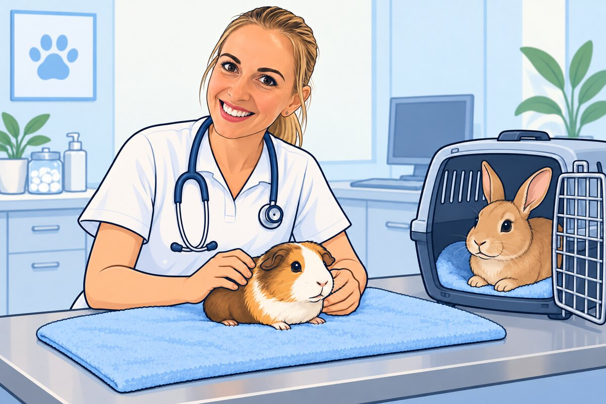

Am **14. September 2026** sprach Fachtierärztin [Mag. Jennifer Malandi](/team/jennifermalandi/) über Erste Hilfe für Kaninchen, Meerschweinchen und Ratten. Im Mittelpunkt stand eine Frage, die zu Hause oft schwer zu beantworten ist: Kann ich mein Tier noch beobachten, oder braucht es sofort tierärztliche Hilfe?

## Wenn kleine Veränderungen auffallen

Kleine Heimtiere zeigen oft nur unauffällig, dass es ihnen schlecht geht. Der Vortrag nahm deshalb Situationen aus dem Alltag in den Blick: Ein Kaninchen lässt sein Futter liegen, ein Meerschweinchen atmet angestrengt, oder nach einem Streit im Gehege fällt eine Bisswunde auf. Auch der Verdacht auf eine Vergiftung und die Ausstattung einer Notfallapotheke für Heimtiere waren Thema.

<figure>
  
</figure>

Mehr über die [Untersuchung kleiner Heimtiere in unserer Ordination](/kleine-heimtiere/). Weitere Veranstaltungstermine finden Sie, sobald sie feststehen, in unserer [Webinarübersicht](/webinare/).
