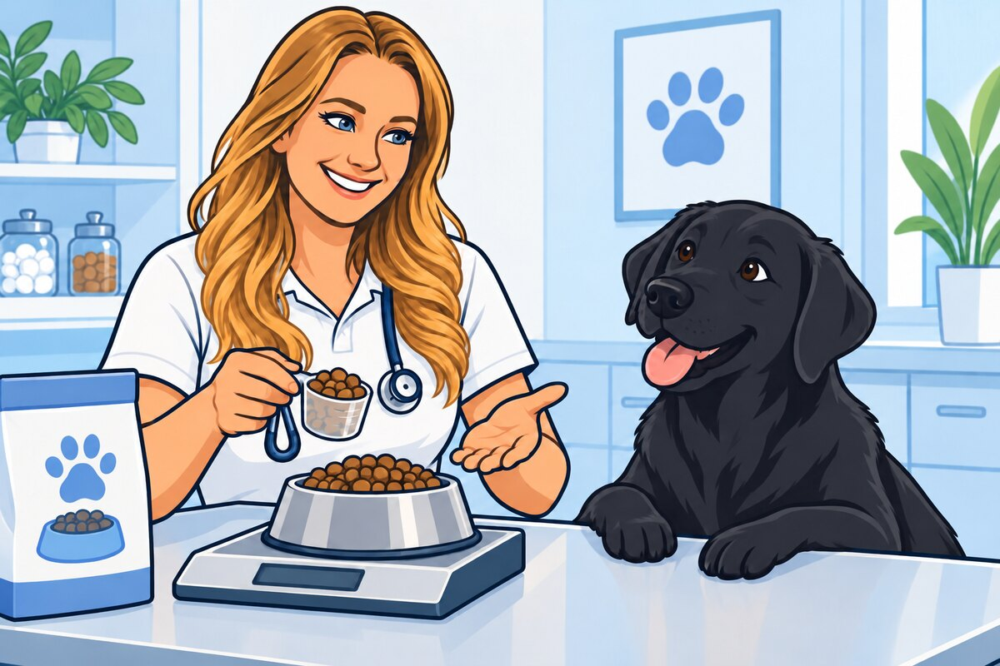

**Das Webinar fand am 14. November 2026 statt.** Unter dem Titel „Futterdschungel Hund – Was kommt wirklich in den Napf?“ nahm sich Fachtierärztin [Mag. Jennifer Malandi](/team/jennifermalandi/) die Fragen vor, die viele Hundehalterinnen und Hundehalter schon vor dem Futterregal beschäftigen.

## Was sagt die Packung über das Futter aus?

Trockenfutter, Nassfutter, BARF oder selbst gekocht: Im Webinar ging es um die Unterschiede zwischen diesen Fütterungsformen. Ein zweiter Schwerpunkt waren Angaben wie „getreidefrei“, „hypoallergen“ und „hoher Fleischanteil“. Was verraten sie über ein Futter, und was muss man über den eigenen Hund wissen, um es für ihn auswählen zu können?

<figure>
  
</figure>

Wenn Sie die Fütterung Ihres eigenen Hundes besprechen möchten, erfahren Sie hier mehr über unsere [tierärztliche Ernährungsberatung](/ernaehrungsberatung/). Weitere Veranstaltungstermine finden Sie, sobald sie feststehen, in unserer [Webinarübersicht](/webinare/).

**Tierarztpraxis am Mühlgrund**  
Langobardenstraße 44, 1220 Wien  
[www.tierarzt.cc](https://tierarzt.cc/) · Tel.: [01 / 28 32 779](tel:+4312832779)
